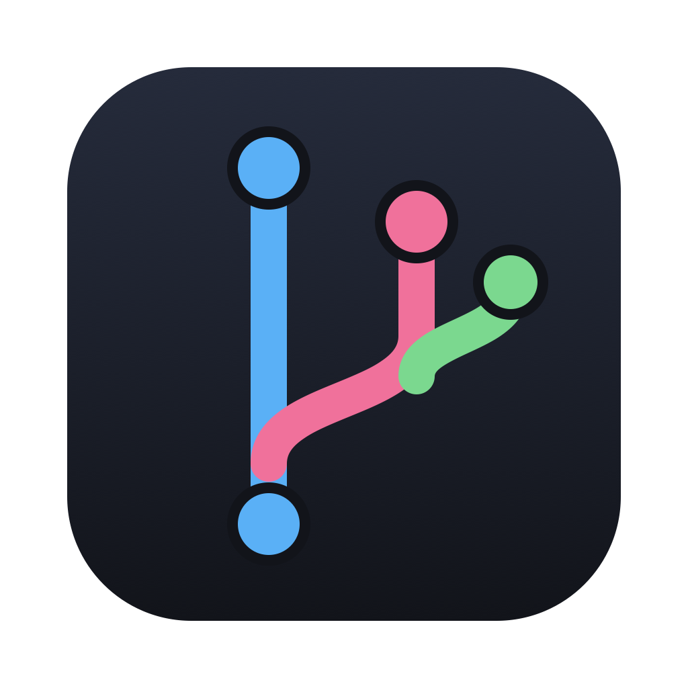
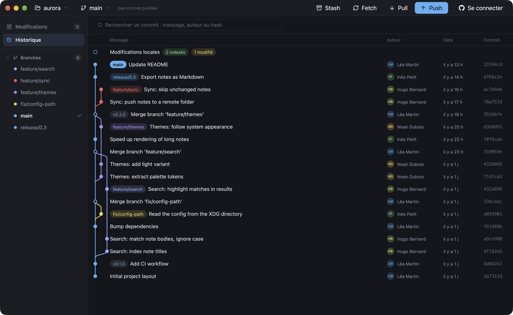
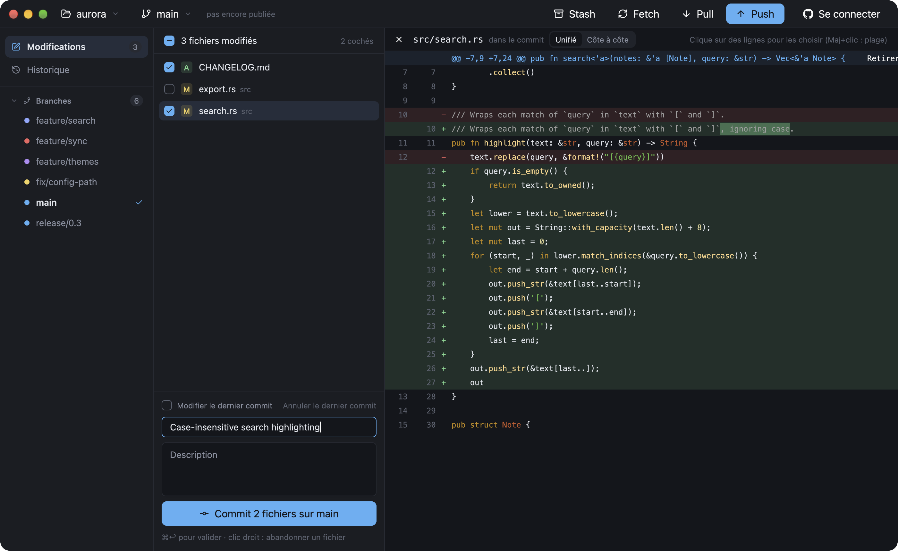

<div align="center">



# Rameau

**Un client Git rapide et natif, écrit en Rust.**<br>
Graphe de commits coloré, commit ligne par ligne, rebase interactif, pull requests et CI en un coup d'œil.<br>
Environ deux fois moins de mémoire que GitHub Desktop, ouvert en 0,2 s. Sans Electron.

[](https://github.com/emmanuellion/rameau/releases/latest)
[](https://github.com/emmanuellion/rameau/releases)
[](LICENSE)
[](https://www.gpui.rs)

[**Télécharger**](https://github.com/emmanuellion/rameau/releases/latest) &nbsp;|&nbsp;
[Site](https://emmanuellion.github.io/rameau/) &nbsp;|&nbsp;
[Fonctionnalités](#fonctionnalités) &nbsp;|&nbsp;
[Performances](#performances) &nbsp;|&nbsp;
[Compiler](#compiler-depuis-les-sources) &nbsp;|&nbsp;
[English](README.md)

<br>

<picture>
  <source media="(prefers-color-scheme: light)" srcset="assets/screenshots/light.png">
  
</picture>

</div>

## Pourquoi Rameau

- **Natif, rendu par le GPU.** Construit sur [GPUI](https://www.gpui.rs), le framework de l'éditeur Zed.
  Un seul processus, pas d'Electron, pas de navigateur embarqué : environ deux fois moins de mémoire que
  GitHub Desktop, et la fenêtre s'affiche en 0,2 s ([mesures](#performances)).
- **Pensé pour les développeurs.** Navigation au clavier, commit ligne par ligne, rebase interactif et gestion
  des conflits à un clic, sans cacher ce que fait Git.
- **Une interface moderne et lisible.** Chaque branche garde sa couleur dans le graphe (`origin/x` a la même que `x`),
  diffs colorés avec les changements mot à mot, en vue unifiée ou côte à côte, thème clair et sombre.
- **Libre.** GPL-3.0, sans compte ni télémétrie. Rameau utilise ton `git` et tes identifiants.

## Fonctionnalités

| | |
|---|---|
| **Historique** | Graphe coloré, tags, branches locales et distantes, détail des commits, recherche par message, auteur ou hash |
| **Commit** | Cocher les fichiers, ou choisir des lignes/blocs dans le diff (Maj+clic pour une plage) |
| **Modifier, annuler** | Modifier le dernier commit, ou l'annuler : ses modifications reviennent cochées, avec son message |
| **Diffs** | Coloration syntaxique, changements mot à mot, vue unifiée ou côte à côte, par commit ou pour les modifications locales |
| **Branches** | Checkout, merge, rebase, création, suppression locale ou sur le serveur (clic droit) |
| **Rebase interactif** | Réordonner, reformuler, fusionner ou supprimer des commits |
| **Stash** | Créer, appliquer, supprimer |
| **Conflits** | Bandeau « Merge/Rebase en cours » avec Continuer / Annuler |
| **GitHub** | Connexion par device flow, cloner un de tes dépôts depuis une liste, voir la pull request et le résultat de CI de chaque branche, ouvrir une pull request en un clic |
| **Distant** | Push, pull, fetch |
| **Projets** | Ouvrir un dossier, cloner une adresse, créer un dépôt, glisser-déposer ; passer d'un projet à l'autre |
| **Confort** | Thème clair ou sombre, panneaux redimensionnables, identité git, abandon de modifications par fichier ou par ligne |

Clavier : <kbd>↑</kbd> <kbd>↓</kbd> parcourir l'historique, <kbd>Échap</kbd> fermer le diff &nbsp;|&nbsp;
<kbd>⌘</kbd>+<kbd>↩</kbd> (<kbd>Ctrl</kbd>+<kbd>↩</kbd> sous Linux/Windows) valider le commit.

<picture>
  <source media="(prefers-color-scheme: light)" srcset="assets/screenshots/commit-light.png">
  
</picture>

## Performances

Rameau à côté de GitHub Desktop, sur la même machine, les mêmes dépôts et la même taille de fenêtre.

| | Rameau | GitHub Desktop 3.6.11 |
|---|---:|---:|
| Mémoire, petit dépôt (18 commits), au repos | **76 Mo** | 221 Mo |
| Mémoire, petit dépôt, après avoir parcouru l'historique | **100 Mo** | 213 Mo |
| Mémoire, [git/git](https://github.com/git/git) (82 925 commits), au repos | **122 Mo** | 247 Mo |
| Mémoire, git/git, après avoir parcouru 50 commits | **154 Mo** | 248 Mo |
| Délai d'apparition de la fenêtre | **0,18 s** | 0,87 s |
| Processus | **1** | 4 |
| Taille installée sur macOS | **116 Mo** (Intel + Apple Silicon) | 1,1 Go (dont 652 Mo de Git embarqué) |

<details>
<summary>Méthode de mesure</summary>

MacBook Pro (Apple M5 Pro, 48 Go), macOS 27.0.1, version de développement actuelle de Rameau.
La mémoire est l'*empreinte physique* donnée par `footprint` de macOS, le chiffre affiché par le Moniteur
d'activité, additionnée sur tous les processus de l'app. Chaque app est quittée, relancée sur le dépôt,
redimensionnée en 1400×900 et passée sur sa vue Historique. La mémoire est relevée 20 s après le lancement, puis
après 50 appuis sur ↓ dans l'historique. Chaque valeur est la médiane de 5 relevés, et le tableau donne la
médiane de 3 lancements. GitHub Desktop affiche aussi le diff du premier fichier de chaque commit sélectionné,
Rameau le détail du commit et sa liste de fichiers. Rameau a besoin de Git sur la machine ; GitHub Desktop
embarque le sien.
</details>

## Installation

Télécharge la dernière version sur la page [**Releases**](https://github.com/emmanuellion/rameau/releases/latest).
**Git doit être installé** : Rameau s'appuie sur le `git` de ta machine pour les commits, push, merge…

| Système | Fichier |
|---|---|
| macOS 11+ (Apple Silicon et Intel) | `rameau-…-macos-universal.dmg` |
| Windows 10/11 (x64) | `rameau-…-windows-x86_64.zip` |
| Linux (x64 / ARM64) | `rameau-…-linux-x86_64.AppImage`, `…-aarch64.AppImage`, ou les `.tar.gz` |

<details>
<summary><b>macOS</b> : premier lancement</summary>

Ouvre le `.dmg` et glisse Rameau dans Applications. L'app n'est pas encore notarisée par Apple : au premier
lancement, va dans **Réglages Système › Confidentialité et sécurité** et clique sur **Ouvrir quand même**, ou :

```sh
xattr -dr com.apple.quarantine /Applications/Rameau.app
```
</details>

<details>
<summary><b>Windows</b> : SmartScreen</summary>

Installe [Git pour Windows](https://git-scm.com/download/win), dézippe l'archive et lance `rameau.exe`.
Si SmartScreen affiche « Windows a protégé votre ordinateur » : **Informations complémentaires › Exécuter quand même**.
</details>

<details>
<summary><b>Linux</b> : AppImage</summary>

```sh
chmod +x rameau-*-linux-x86_64.AppImage
./rameau-*-linux-x86_64.AppImage
```

Il faut un pilote Vulkan (`mesa-vulkan-drivers` sur Intel/AMD, le pilote propriétaire sur NVIDIA).
Sans FUSE, utilise l'archive `.tar.gz`.
</details>

Chaque release fournit `SHA256SUMS.txt` pour vérifier les fichiers.

## Compiler depuis les sources

```sh
git clone https://github.com/emmanuellion/rameau && cd rameau
cargo run --release                         # rouvre le dernier projet, ou la page d'import
cargo run --release -- /chemin/du/projet    # ouvre (et importe) ce projet
cargo test
```

<details>
<summary>Dépendances de compilation sous Linux (Ubuntu/Debian)</summary>

```sh
sudo apt install build-essential pkg-config cmake clang git \
  libfontconfig-dev libfreetype-dev libwayland-dev libxkbcommon-dev libxkbcommon-x11-dev \
  libx11-xcb-dev libxcb1-dev libvulkan1 libzstd-dev
```
</details>

Empaqueter à la main : `scripts/package-macos.sh` (`.app` + `.dmg`) et `scripts/package-linux.sh`
(AppImage + `.tar.gz`).

<details>
<summary>Publier une version</summary>

1. Change `version` dans `Cargo.toml`, puis `cargo check` (met à jour `Cargo.lock`), et commite.
2. `git tag v0.2.0 && git push origin main v0.2.0`

La pipeline [Release](.github/workflows/release.yml) compile macOS (universel), Linux (x64, ARM) et
Windows (x64), puis publie la release GitHub avec les paquets et leurs sommes SHA-256.
Elle refuse un tag qui ne correspond pas à la version de `Cargo.toml`.
</details>

<details>
<summary>Configuration et identifiants</summary>

Les projets importés et les préférences sont dans `~/Library/Application Support/rameau/config.json`
(macOS), `~/.config/rameau/config.json` (Linux) ou `%APPDATA%\rameau\config.json` (Windows).

La connexion GitHub utilise le *device flow* OAuth : clic sur « Connexion GitHub », le code est copié, la page
GitHub s'ouvre, on colle le code et on valide. Le token est rangé par le gestionnaire d'identifiants de git
(Trousseau sur macOS, Credential Manager sur Windows, libsecret s'il est configuré) ; sans gestionnaire, dans
`~/.config/rameau/credentials`, lisible par l'utilisateur seul.

Le *Client ID* de l'OAuth App Rameau est dans `.cargo/config.toml` (il est public : pas de secret dans le binaire).
Pour utiliser ta propre OAuth App : crée-la sur https://github.com/settings/applications/new, coche
**Enable Device Flow**, et remplace l'identifiant.
</details>

## Contribuer

Bugs, idées et pull requests sont les bienvenus : ouvre une [issue](https://github.com/emmanuellion/rameau/issues).
Si Rameau te sert, une ⭐ aide d'autres développeurs à le trouver.

## Licence

Rameau est un logiciel libre sous licence [GPL-3.0-or-later](LICENSE).
Il s'appuie notamment sur [GPUI](https://github.com/zed-industries/zed) et
[gpui-component](https://github.com/longbridge/gpui-component) (Apache-2.0), [libgit2](https://libgit2.org)
(GPL-2.0 avec exception de liaison) et des icônes [Lucide](https://lucide.dev) (ISC, voir `assets/icons/LICENSE`).
