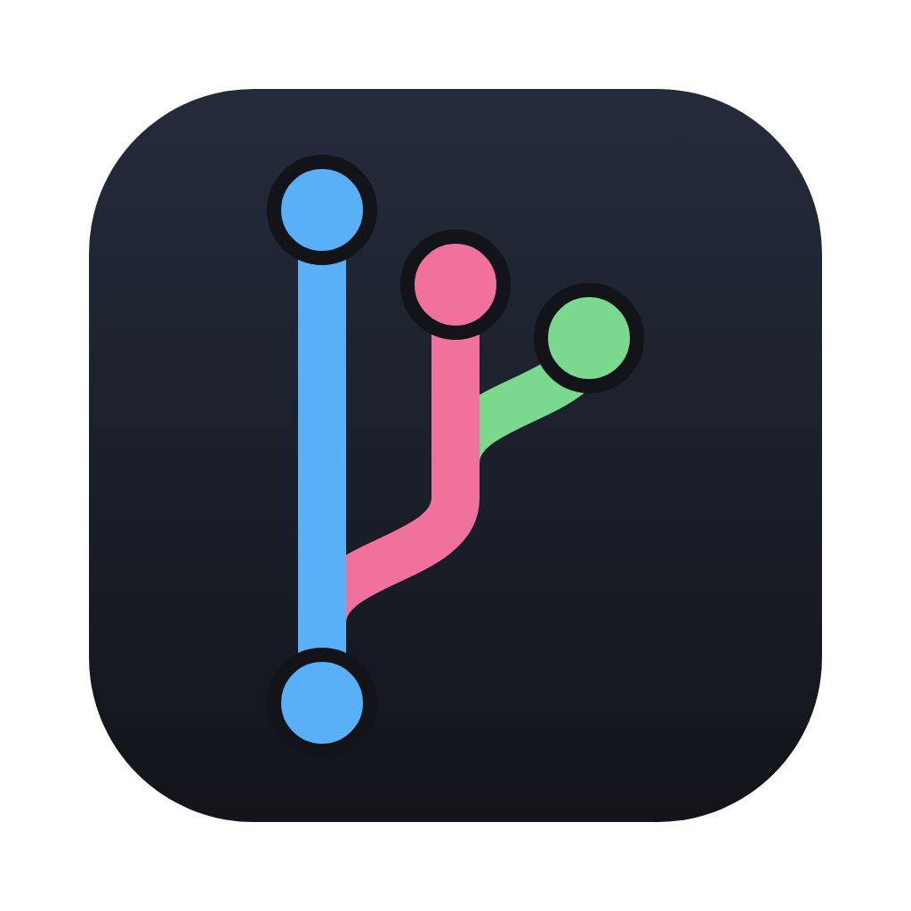
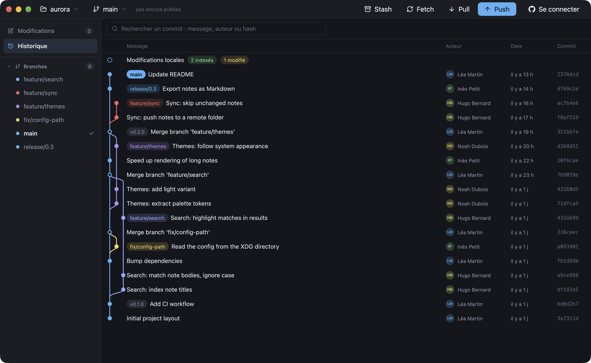
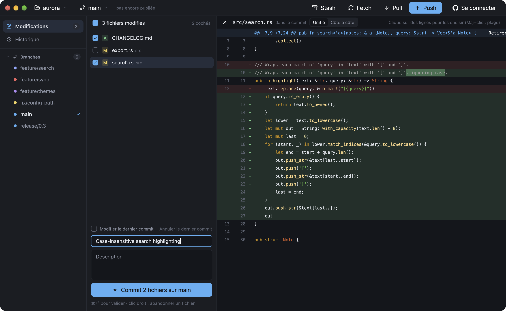

<div align="center">



# Rameau

**A fast, native Git client written in Rust.**<br>
Colored commit graph, line-by-line staging, interactive rebase, pull requests and CI at a glance.<br>
About half the memory of GitHub Desktop, open in 0.2 s. No Electron.

[](https://github.com/emmanuellion/rameau/releases/latest)
[](https://github.com/emmanuellion/rameau/releases)
[](LICENSE)
[](https://www.gpui.rs)

[**Download**](https://github.com/emmanuellion/rameau/releases/latest) &nbsp;|&nbsp;
[Website](https://emmanuellion.github.io/rameau/) &nbsp;|&nbsp;
[Features](#features) &nbsp;|&nbsp;
[Performance](#performance) &nbsp;|&nbsp;
[Build from source](#build-from-source) &nbsp;|&nbsp;
[Français](README.fr.md)

<br>

<picture>
  <source media="(prefers-color-scheme: light)" srcset="assets/screenshots/light.png">
  
</picture>

</div>

## Why Rameau

- **Native and GPU-rendered.** Built on [GPUI](https://www.gpui.rs), the UI framework behind the Zed editor.
  One process, no Electron, no bundled browser: about half the memory of GitHub Desktop,
  and the window is up in 0.2 s ([measurements](#performance)).
- **Made for developers.** Keyboard navigation, line-level staging, interactive rebase and conflict handling
  are one click away, without hiding what Git actually does.
- **A modern, readable interface.** Each branch keeps its own color across the graph (`origin/x` matches `x`),
  syntax-highlighted diffs with word-level changes, unified or side by side, light and dark themes.
- **Free and open source.** GPL-3.0, no account, no telemetry. It uses your own `git` and credentials.

## Features

| | |
|---|---|
| **History** | Colored commit graph, tags, local and remote branches, commit details, search by message, author or hash |
| **Commit** | Stage whole files, or pick individual lines and hunks from the diff (Shift+click for a range) |
| **Amend and undo** | Amend the last commit, or undo it: its changes come back staged, with its message |
| **Diffs** | Syntax highlighting, word-level changes, unified or side-by-side view, per commit or for local changes |
| **Branches** | Checkout, merge, rebase, create, delete locally or on the remote (right-click) |
| **Commits** | Cherry-pick, revert, reset (soft, mixed, hard), create, publish and delete tags (right-click) |
| **Interactive rebase** | Reorder, reword, squash or drop commits |
| **Stash** | Stash, apply, delete |
| **Conflicts** | Pick a side for each conflict block (HEAD, incoming, both) or for the whole file, then Continue / Abort from the banner |
| **GitHub** | Sign in with the device flow, clone one of your repositories from a list, see each branch's pull request and CI result, open a pull request in one click |
| **Remotes** | Push, pull, fetch, automatic fetch every 5 minutes |
| **Projects** | Open a folder, clone a URL, create a repository, drag and drop; switch between projects |
| **Comfort** | Light and dark themes, resizable panels, git identity setup, discard changes per file or per line |

Keyboard (<kbd>⌘</kbd> on macOS, <kbd>Ctrl</kbd> on Linux/Windows): <kbd>↑</kbd> <kbd>↓</kbd> browse history or changed files,
<kbd>Esc</kbd> close the diff, <kbd>⌘</kbd>+<kbd>↩</kbd> commit, <kbd>⌘</kbd>+<kbd>1</kbd> / <kbd>2</kbd> changes / history,
<kbd>⌘</kbd>+<kbd>F</kbd> search, <kbd>⌘</kbd>+<kbd>P</kbd> push, <kbd>⌘</kbd>+<kbd>⇧</kbd>+<kbd>P</kbd> pull,
<kbd>⌘</kbd>+<kbd>⇧</kbd>+<kbd>F</kbd> fetch, <kbd>⌘</kbd>+<kbd>R</kbd> or <kbd>F5</kbd> refresh.

<picture>
  <source media="(prefers-color-scheme: light)" srcset="assets/screenshots/commit-light.png">
  
</picture>

> The interface is currently in French.

## Performance

Rameau next to GitHub Desktop, on the same machine, the same repositories and the same window size.

| | Rameau | GitHub Desktop 3.6.11 |
|---|---:|---:|
| Memory, small repository (18 commits), idle | **76 MB** | 221 MB |
| Memory, small repository, after browsing its history | **100 MB** | 213 MB |
| Memory, [git/git](https://github.com/git/git) (82,925 commits), idle | **122 MB** | 247 MB |
| Memory, git/git, after browsing 50 commits | **154 MB** | 248 MB |
| Time until the window appears | **0.18 s** | 0.87 s |
| Processes | **1** | 4 |
| Installed size on macOS | **116 MB** (Intel + Apple Silicon) | 1.1 GB (652 MB of it is a bundled Git) |

<details>
<summary>How it was measured</summary>

MacBook Pro (Apple M5 Pro, 48 GB), macOS 27.0.1, Rameau's current development version.
Memory is the *physical footprint* reported by macOS `footprint`, the figure Activity Monitor shows,
summed over every process of the app. Each app was quit, relaunched on the repository, resized to 1400×900 and
switched to its history view. Memory was sampled 20 s after launch, then again after pressing ↓ 50 times in the
history. Each value is the median of 5 samples, and the table shows the median of 3 launches.
GitHub Desktop also renders the diff of the first file of each selected commit, while Rameau shows the commit
details and its file list. Rameau needs Git installed on the machine; GitHub Desktop ships its own.
</details>

## Install

Grab the latest build from the [**Releases page**](https://github.com/emmanuellion/rameau/releases/latest).
**Git must be installed**: Rameau runs your machine's `git` for commits, push, merge…

| System | File |
|---|---|
| macOS 11+ (Apple Silicon and Intel) | [`rameau-macos-universal.dmg`](https://github.com/emmanuellion/rameau/releases/latest/download/rameau-macos-universal.dmg) |
| Windows 10/11 (x64) | [`rameau-windows-x86_64-setup.exe`](https://github.com/emmanuellion/rameau/releases/latest/download/rameau-windows-x86_64-setup.exe) (installer) or [`rameau-windows-x86_64.zip`](https://github.com/emmanuellion/rameau/releases/latest/download/rameau-windows-x86_64.zip) (portable) |
| Linux (x64 / ARM64) | [`rameau-linux-x86_64.AppImage`](https://github.com/emmanuellion/rameau/releases/latest/download/rameau-linux-x86_64.AppImage), [`rameau-linux-aarch64.AppImage`](https://github.com/emmanuellion/rameau/releases/latest/download/rameau-linux-aarch64.AppImage), or the `.tar.gz` |

<details>
<summary><b>macOS</b>: first launch</summary>

Open the `.dmg` and drag Rameau into Applications. The app is not notarized by Apple yet, so on first launch go to
**System Settings › Privacy & Security** and click **Open Anyway**, or run:

```sh
xattr -dr com.apple.quarantine /Applications/Rameau.app
```
</details>

<details>
<summary><b>Windows</b>: SmartScreen</summary>

Install [Git for Windows](https://git-scm.com/download/win), then run `rameau-setup.exe`. It installs Rameau for your
account (no admin rights needed) with a Start menu shortcut, and uninstalls from **Settings › Apps**.
For the portable version, unzip the `.zip` and run `rameau.exe`.
If SmartScreen shows "Windows protected your PC", click **More info › Run anyway**.
</details>

<details>
<summary><b>Linux</b>: AppImage</summary>

```sh
chmod +x rameau-linux-x86_64.AppImage
./rameau-linux-x86_64.AppImage
```

A Vulkan driver is required (`mesa-vulkan-drivers` on Intel/AMD, the proprietary driver on NVIDIA).
Without FUSE, use the `.tar.gz` archive instead.
</details>

Every release ships `SHA256SUMS.txt` to verify the downloads.

## Build from source

```sh
git clone https://github.com/emmanuellion/rameau && cd rameau
cargo run --release                       # reopens the last project, or the import page
cargo run --release -- /path/to/project   # opens (and imports) this project
cargo test
```

<details>
<summary>Linux build dependencies (Ubuntu/Debian)</summary>

```sh
sudo apt install build-essential pkg-config cmake clang git \
  libfontconfig-dev libfreetype-dev libwayland-dev libxkbcommon-dev libxkbcommon-x11-dev \
  libx11-xcb-dev libxcb1-dev libvulkan1 libzstd-dev
```
</details>

Packaging: `scripts/package-macos.sh` (`.app` + `.dmg`), `scripts/package-linux.sh` (AppImage + `.tar.gz`) and
`packaging/windows/rameau.iss` ([Inno Setup](https://jrsoftware.org/isinfo.php) installer).
Development happens on the `develop` branch. Releases are built by the
[Release workflow](.github/workflows/release.yml) when a `v*` tag matching `Cargo.toml` is pushed on a commit of `main`.

<details>
<summary>Where settings and credentials live</summary>

Imported projects and preferences: `~/Library/Application Support/rameau/config.json` (macOS),
`~/.config/rameau/config.json` (Linux), `%APPDATA%\rameau\config.json` (Windows).

GitHub sign-in uses the OAuth device flow. The token is stored by git's credential manager (Keychain on macOS,
Credential Manager on Windows, libsecret when configured), otherwise in `~/.config/rameau/credentials`,
readable by your user only. The public OAuth *Client ID* is in `.cargo/config.toml`; to use your own OAuth App,
create one at https://github.com/settings/applications/new with **Enable Device Flow** checked and replace it.
</details>

## Contributing

Bug reports, ideas and pull requests are welcome: open an [issue](https://github.com/emmanuellion/rameau/issues).
If Rameau is useful to you, a ⭐ helps other developers find it.

## License

Rameau is free software under the [GPL-3.0-or-later](LICENSE) license.
It builds on [GPUI](https://github.com/zed-industries/zed) and [gpui-component](https://github.com/longbridge/gpui-component)
(Apache-2.0), [libgit2](https://libgit2.org) (GPL-2.0 with linking exception) and [Lucide](https://lucide.dev) icons (ISC).
